# NativeDraft

**A screenwriting studio for Linux, macOS and Windows.** Free and open source, by
[NativeCompute](https://nativecompute.net).

It behaves like a notes app — open it, type, it saves itself — but every
paragraph is a typed screenplay element, laid out to standard master-scene
geometry and exportable as a print-ready PDF, a Final Draft file or Fountain.

Scripts are stored as plain markdown — in `~/.local/share/nativedraft/scripts`
on Linux, `~/Library/Application Support/NativeDraft/scripts` on a Mac,
`%APPDATA%\NativeDraft\scripts` on Windows — so your work stays greppable,
diffable, and yours.

NativeDraft is drawn in NativeCompute's design language, the same one as
[NativeCompute's own website](https://nativecompute.net): solid tiles on a
soft wallpaper, clear glass for the chrome that floats over them, one coral
accent with ink text on it, and four bright tiles (coral, lilac, sun and sky)
for the things worth a glance. Bricolage Grotesque sets the display type and
Plus Jakarta Sans everything else, labels and figures included; the script
itself is Courier Prime. It follows your computer's light or dark setting.

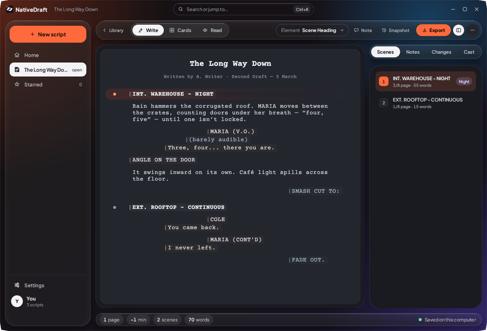

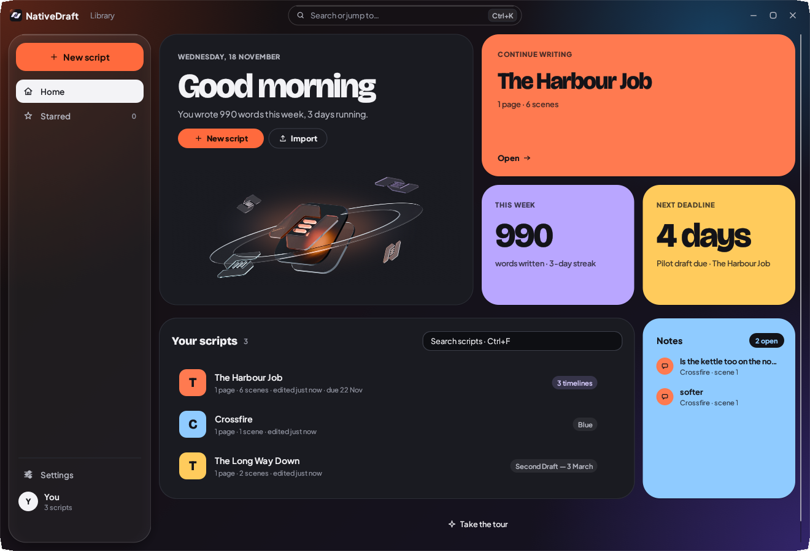

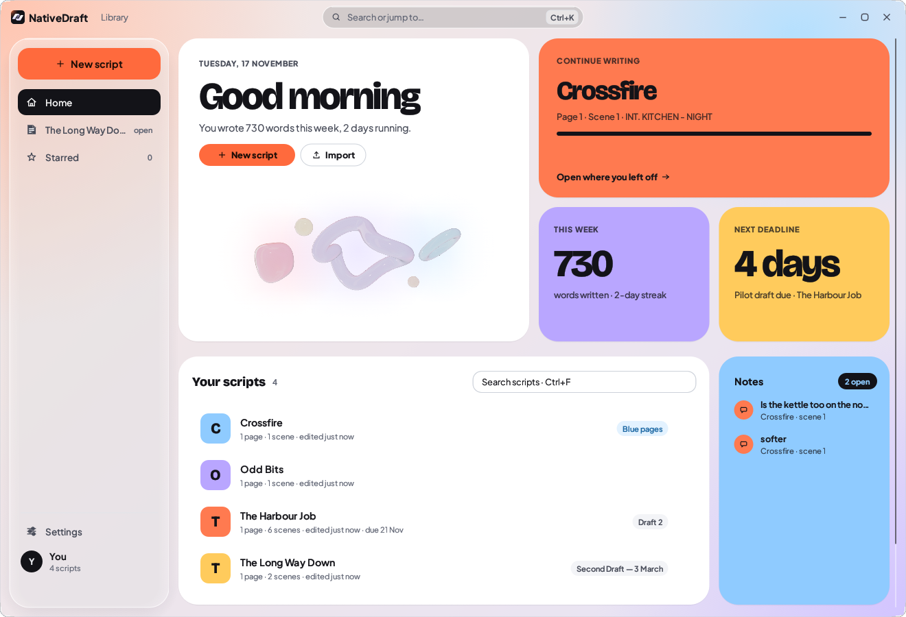

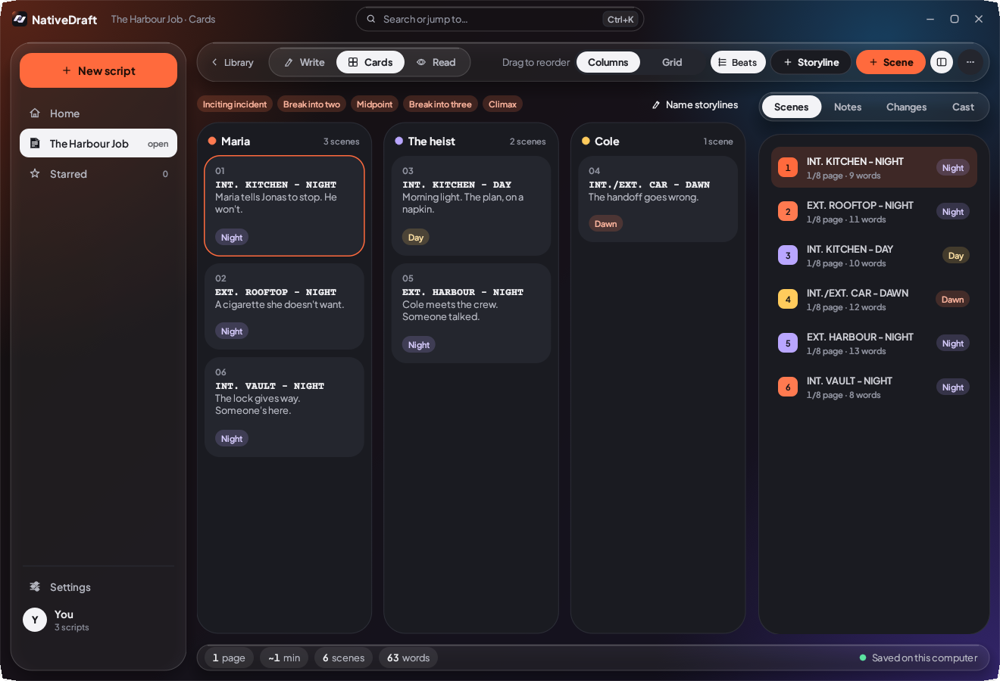

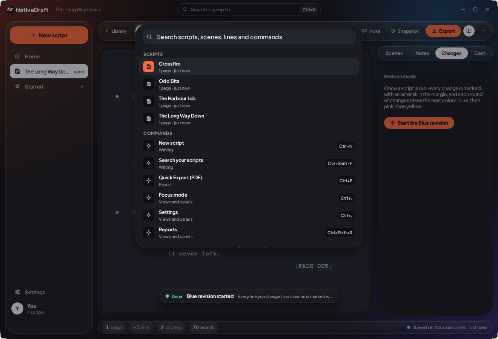

---

## Coming next: a new look

**Blackline is now NativeDraft.** Same app, same scripts, a new name:

- **Your scripts stay where they are.** If you used Blackline, NativeDraft opens
  your library from the Blackline folder (`~/.local/share/blackline`,
  `~/Library/Application Support/Blackline` or `%APPDATA%\Blackline`) and
  never moves or copies it. New installs get a `nativedraft` folder.
- **It arrives as an update.** Blackline offers NativeDraft like any other
  update. On Linux, `~/.local/bin/blackline` keeps working as a link to
  `nativedraft`; on a Mac, `NativeDraft.app` takes the place of `Blackline.app`;
  on Windows the program keeps its file name until you install fresh.
- **Settings, sign-in and NativeCloud** carry over: your cloud scripts, your
  computer's sign-in and anything not yet synced are all still there.

Not released yet; this is what the next version brings.

- **A new layout.** Your library sits in a glass sidebar on the left (it
  folds to a rail when the window is narrow, and hides in Focus). The tools
  float in a glass pill above the page; Scenes, Notes, Changes and Cast share
  tabs on the right; the page count, words and save state sit in a pill along
  the bottom.
- **Search or jump to.** `Ctrl+K`, or the search in the title bar: one list of
  your scripts, the scenes in the open one, lines in every script and every
  command with its shortcut. Arrow keys and `Enter` pick; `Esc` closes.
- **Storylines in columns.** Cards opens on a column per storyline. Drag a
  card into another column to change its storyline, or up and down to move
  the scene in the script. The beats sit as chips above. *+ Storyline* starts
  an empty column; the grid with its timeline is one click away.
- **The title page, on the page.** The script's title and byline sit at the
  top of the page. Click them, or press `Ctrl+I`, for the title page: title,
  author, draft, contact, cover and deadline.
- **This week and what's due.** Home counts the words you write each day and
  shows the week's total and your streak. Give a script a deadline on its
  title page and the nearest one shows on Home as *4 days*, *Tomorrow* or
  *Today*. The word log and the places you left off are kept with your
  settings, never in a script; a deadline is one line in the script's front
  matter (`deadline: 2026-11-20 Pilot draft due`), written only once you set
  one.
- **Labels you can read.** Labels and figures are Plus Jakarta Sans in
  sentence case, with figures that line up; the only capitals left are small
  eyebrows such as *Continue writing*.
- **Light, dark, or your system.** Settings → Appearance has System, Light and
  Dark. System follows your computer and changes when it does. When the
  computer says nothing (some Linux desktops), NativeDraft goes dark.
- **A new Home.** A hero with glass art and a greeting, then a coral tile that
  opens the script you were in on the page and scene you left, the week's
  words in lilac, the next deadline in sun, your scripts as a list, and either
  the writers' room or your latest notes in sky.
- **Covers.** Every script has a cover colour: coral, lilac, sun or sky. Pick
  one from the script's menu on Home or on its title page. A script with
  no cover picked gets one from its file name, so it doesn't move.
- **Characters in colour.** The first six speakers get the six bright colours,
  on screen and in the PDF; the rest still get a colour each.
- **A new icon.** The ribbon mark on an ink tile with a coral glow, for the
  window, the dock and the installer.
- **Reports** opens on four tiles: pages, scenes, speaking parts and locations.
- **Timelines.** Branch the story at any scene, as many times and as deep as
  you like, and see every branch as a graph. See [Timelines](#timelines)
  below.

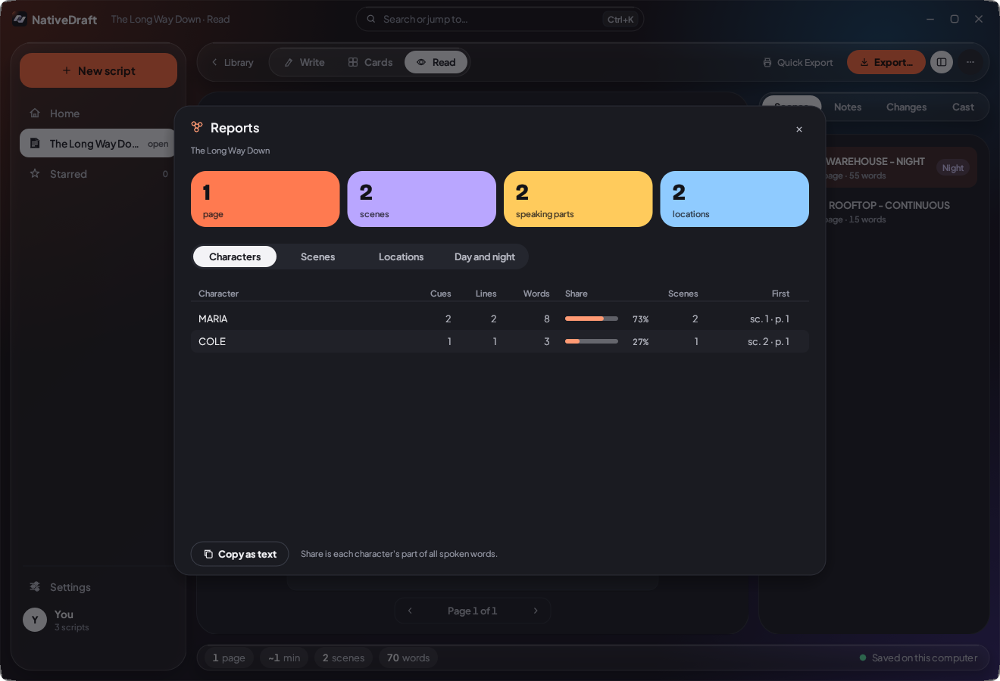

---

## New in 2.3: a cleaner launch

- **Updates are asked about up front.** When a new version is out, the
  splash card turns into a short question as Blackline opens: **Update
  now**, **Not now** or **Skip this version**. With the splash turned off,
  the same card appears over the window. See [Updates](#updates).
- **A leaner launch.** The splash and the updater window are shorter, with
  the empty space gone.
- **Notifications that look like Blackline.** Saved, renamed, warnings and
  errors are square readouts with a coloured edge and a label, and
  confirmations use the normal buttons.

## New in 2.2: on the Mac

- **Blackline runs on macOS** 11 Big Sur and newer, as one app for Apple
  Silicon and Intel. Install it with one line in Terminal (see
  [Installing](#on-a-mac)).
- It is a proper Mac app: the Mac's own window frame and full screen, Metal
  graphics, the system Open panel, *Show in Finder*, `Cmd` and `Option` in
  every hint, and your scripts in `~/Library/Application Support/Blackline`.
- **Quitting saves** whatever you typed in the last few seconds, however the
  app is quit: `Cmd+Q`, the menu, logging out or shutting down.
- **Updates in one click**, on every platform: when a new version is out,
  Blackline asks as it opens. *Update now* installs it in a small updater
  window and opens Blackline again. See [Updates](#updates).

## New in 2.1: Blue Pages

Named after the first round of production changes, which go out on blue paper.

- **Dual dialogue.** Two characters talking at once. Put the cursor in the
  second speech and press `Ctrl+D`; the pair sits side by side in the editor,
  in Reading mode and in print, and is never split across a page. Fountain
  (`^`) and Final Draft carry it both ways.
- **Script notes.** `Ctrl+M`, or right-click a line, to leave yourself a note.
  A marker sits in the margin, the note itself shows beside the page when the
  window is wide enough, and the panel on the left lists every note with its
  page and scene. Notes only print when you ask, as endnotes.
- **Revision mode.** Start a revision from the *Changes* tab. Every changed
  line gets an asterisk in the margin, changed pages carry a header such as
  `Blue Rev. 11/04/26`, and each round takes the next colour: blue, pink,
  yellow, green, goldenrod, buff, salmon, cherry. **Lock pages** keeps every
  page on its number; new material goes onto A-pages (`12A`, `12B`). Export can
  print just the changed pages, on tinted paper if you like.
- **Reports.** `Ctrl+Shift+R`: characters (cues, lines, words, share of the
  dialogue, first appearance), scenes, locations and day and night, all
  measured on the printed layout, each one copyable as text.
- **Find across all scripts.** Home's search looks inside every script, not
  just titles; a click opens the script on that line. `Ctrl+Shift+F` gets
  there from anywhere.
- **Beat tools in Cards.** Name the card colours as storylines and filter the
  board by them. A timeline shows the whole script to scale, coloured by
  storyline, with act breaks and guides at the usual turning points.
- **A gentler first run.** A short tour for new people, and a *what's new* for
  people updating, shown once. *Take the tour* on Home brings it back.
- **Imports that say what changed.** Anything a Fountain or Final Draft file
  had that Blackline could not keep exactly is listed, with a link to where it
  happened.
- **More room to write.** The script list has left the writing view; the
  *Library* button at the left of the ribbon goes back to it.
- **Update status** on the splash, and a notice on Home when a new version is
  out, with a *Download* button.

Every script from an earlier Blackline opens and saves exactly as before. The
new markers are only written into a script once you use the feature.


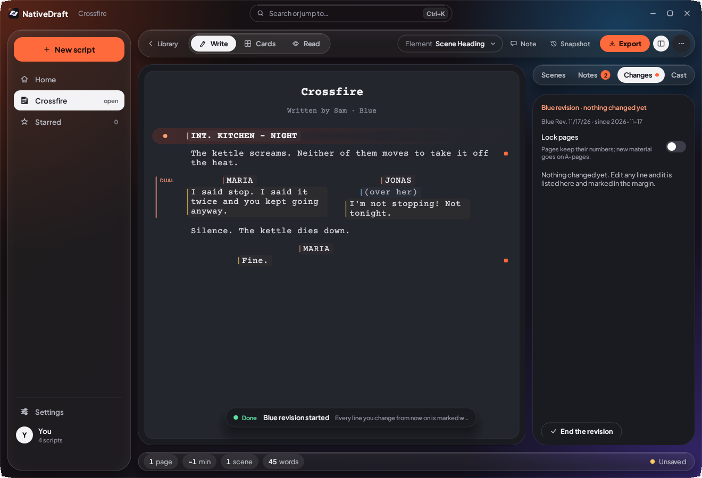

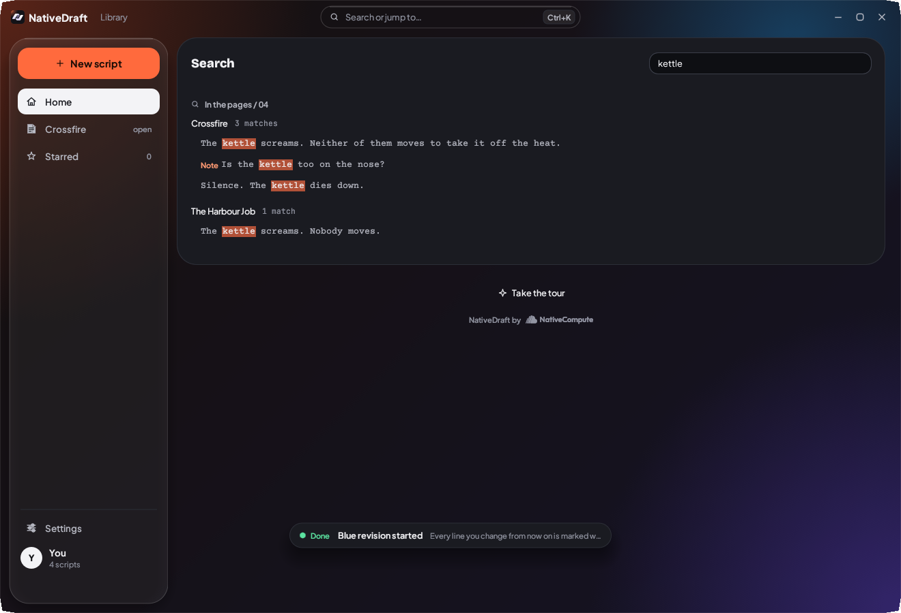

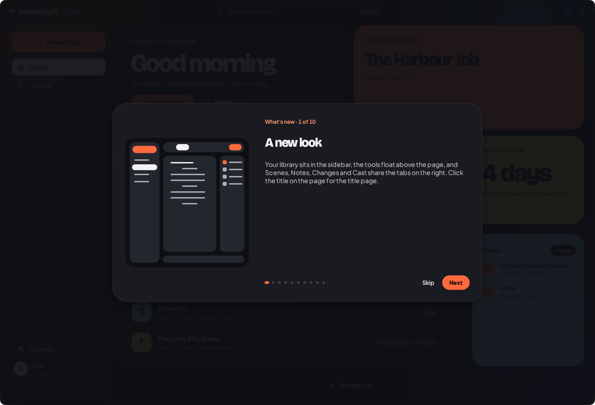

---

## Installing

### On a Mac

macOS 11 Big Sur or newer, on Apple Silicon or Intel. Open **Terminal** (in
Applications → Utilities), paste this line and press Return:

```bash
curl -fsSL https://github.com/NativeCompute/NativeDraft/releases/latest/download/install-macos.sh | bash
```

It downloads the latest release, checks it against its checksum, puts
**NativeDraft** in your Applications folder (`~/Applications` if your account
cannot write to `/Applications`) and opens it. Nothing needs your password.

- **Updating:** click **Update now** when NativeDraft says a new version is out
  (see [Updates](#updates)), or run the same line again. If NativeDraft is
  open, the line waits for you to quit it (`Cmd+Q`) and carries on.
- **Your scripts** live in `~/Library/Application Support/NativeDraft/scripts`.
  Before every install the whole library is copied to
  `~/Library/Application Support/NativeDraft-backup-<date>`; nothing in it is
  moved or changed.
- **Uninstalling:** the same line, ending in `bash -s -- --uninstall`:

  ```bash
  curl -fsSL https://github.com/NativeCompute/NativeDraft/releases/latest/download/install-macos.sh | bash -s -- --uninstall
  ```

  or drag NativeDraft from Applications to the Bin. Your scripts stay where
  they are.

**Downloading the .zip instead.** The release also has
`nativedraft-<version>-macos-universal.zip`. Unzip it and drag **NativeDraft** into
Applications. NativeDraft is not signed with a paid Apple developer certificate,
so the first time you open a copy that came through a browser, macOS stops it:

- **macOS 15 Sequoia and later:** open it once and click *Done* when macOS
  says it could not verify it. Then open **System Settings → Privacy &
  Security**, scroll down to *“NativeDraft” was blocked*, click **Open Anyway**
  and confirm.
- **macOS 11 Big Sur to 14 Sonoma:** Control-click (or right-click) NativeDraft
  in Applications, choose **Open**, then **Open** again.

You do this once. Or skip it with one line in Terminal:
`xattr -dr com.apple.quarantine /Applications/NativeDraft.app`. The Terminal
install above never needs any of this.

**From source on a Mac.** You need Apple's command line tools
(`xcode-select --install`) and Rust (`curl --proto '=https' --tlsv1.2 -sSf
https://sh.rustup.rs | sh`). Then:

```bash
git clone https://github.com/NativeCompute/NativeDraft.git
cd nativedraft
./install.sh
```

On a Mac, `install.sh` hands over to `install-macos.sh --from-source`, which
builds `NativeDraft.app` for your Mac and installs it the same way. If a tool is
missing it says which and how to get it.

### Linux and Windows, from a release

Download the latest build from
[Releases](https://github.com/NativeCompute/NativeDraft/releases):

- **Linux** — `nativedraft-<version>-linux-x86_64.tar.gz`. Unpack it and run
  `./install.sh` inside. It installs the binary to `~/.local/bin`, adds a
  launcher entry and icon, and copies your library aside first (see below).
  Nothing is built and nothing is installed with `apt`.
- **Windows** — `nativedraft-<version>-windows-x86_64.zip`. Unpack it anywhere
  and run `nativedraft.exe`. Your scripts live in `%APPDATA%\NativeDraft`.

### From source on Linux

Written for **Pop!\_OS, Debian and Ubuntu** (22.04 and later), on **KDE
Plasma** or GNOME.

```bash
# 1. Rust, from rustup (the version in apt is usually too old for the GUI stack)
curl --proto '=https' --tlsv1.2 -sSf https://sh.rustup.rs | sh
source "$HOME/.cargo/env"

# 2. NativeDraft
git clone https://github.com/NativeCompute/NativeDraft.git
cd nativedraft
./install.sh
```

`install.sh` checks for the build dependencies and installs any that are
missing with `apt` (it asks for your password once, for `sudo`):

```
build-essential pkg-config libgl1-mesa-dev libx11-dev libxcursor-dev
libxrandr-dev libxi-dev libxkbcommon-dev libxkbcommon-x11-dev libwayland-dev
```

then builds with `cargo build --release`, installs the binary to
`~/.local/bin/nativedraft`, and registers a launcher entry and icon so it shows
up in the KDE application menu (the menu cache is rebuilt for you). The icon is
drawn by the app itself (`nativedraft --emit-icon`), so it always matches the
mark inside the app.

If `~/.local/bin` is not on your `PATH`, the script says so and tells you the
line to add.

**Upgrading** from the first NativeDraft: `git pull` (or re-clone) and run
`./install.sh` again. It replaces `~/.local/bin/nativedraft` in place. Your
scripts are untouched and open exactly as before — the file format only grew.
Before every install it also copies your whole library (scripts, snapshots,
settings) to `~/.local/share/nativedraft-backup-<date>`. It only copies: nothing
in your library is moved or changed. Delete old copies whenever you like.

**Uninstalling:** `./install.sh --uninstall` on Linux; on Windows, delete the
folder you unpacked. Your scripts stay in
`~/.local/share/nativedraft`.

Fonts need nothing extra: Bricolage Grotesque (display), Plus Jakarta Sans
(the interface), JetBrains Mono (readouts) and Courier Prime (the page) ship
inside the binary.

---

## The window

NativeDraft has no desktop title bar. It draws its own: the mark, the name and
the three window buttons along the top, the whole strip draggable, a
double-click to maximise, and invisible grips down every edge for resizing.

On a Mac, NativeDraft uses the Mac's own window frame instead: the red, yellow
and green buttons sit at the top left over the title strip, and resizing,
full screen and window tiling are the system's.

The window is the website's wallpaper: coral, sky and lilac washes over a
soft gradient, pastel in light and deep in dark. The title bar holds the
name, where you are (*Crossfire · Cards*) and **Search or jump to…** in the
middle.

The chrome is glass: the library sidebar on the left, the toolbar pill over
the page (Library, the Write | Cards | Read switch, then the tools for the
view) and the status pill along the bottom. What you *work in* is solid: the
page, the cards, the tabs on the right. Below 1180 points the sidebar folds to
a rail of icons.

---

## Four views

The switch near the left of the toolbar (`Ctrl+G` steps through them). Left of
it, **Library** goes back to Home and all your scripts.

**Write** — the script, one typed block per paragraph, at industry indents in
Courier Prime. The block you are in gets a wash of the accent; every scene
heading carries a small dot in the gutter that turns coral while you
are in its scene. A faint rule marks where each printed page will begin, numbered the
way the PDF numbers it.

Each element is signalled by a whisper of a band under its words and a thin
tick at its left edge, in its own colour — scene headings in chrome, cues in
coral, dialogue, parentheticals, transitions and shots in
four more of its hues, and action left neutral. Settings → **Element colours**
turns it off. None of it ever reaches Reading mode or the page.

**Character colours** (Settings, off until you want them) give every speaking
character a colour of their own — their cue and everything they say. Colours
are dealt out in order of first appearance, so a new character never repaints
the others; **Shuffle** deals them again. They can follow you into Reading
mode too, or stay in the editor.

**Cards** — every scene as a card: its number, heading, a synopsis you write
straight onto the card and its time of day. **Columns** (the default) gives
each storyline a column; drag a card into another column to change its
storyline, or up and down to move the whole scene in the script. *Name
storylines* names them, *+ Storyline* opens an empty column, and the beats
(inciting incident, the act breaks, midpoint, climax) sit as chips above;
click one to find its scene. **Grid** lays the cards out in rows under a
timeline of the whole script to scale, with beat guides at 10, 25, 50, 75 and
90 percent of the page count (*Beats* in the toolbar turns them off).
Right-click a card for a storyline colour or to delete the scene (it asks
first, and `Ctrl+Z` brings it back).

**Timelines** — every timeline of the script as a graph (`Ctrl+Shift+G`).
See [Timelines](#timelines).

**Read** — Reading mode: the script exactly as it will print, one page at a
time, typeset, drawn from the same layout pass the PDF is written from — no
bands, tags or stars. The page is sized so all of it is in view, and opens on
the page you were writing. Turn it with `←` `→`, `Page Up` `Page Down`,
`Home` `End`, the scroll wheel, or the control under the page. Click any
line to go and write it.

On the left, the **library sidebar** (`Ctrl+B`): New script, Home, the open
script, Starred, Recently deleted and, when you are signed in, your cloud
and team spaces. Settings and you sit at its foot.

On the right, four tabs (`Ctrl+Shift+I` shows or hides them):

- **Scenes** lists every scene with its number, its length in eighths, its
  word count and a tag for the time of day; click one to jump to it.
- **Notes** lists every note in script order.
- **Changes** lists every line changed in the revision you are running, and
  starts or ends one.
- **Cast** lists everyone who speaks, most lines first — click a name to step
  through their cues — and shows how much of the script is dialogue.

The **title page** (`Ctrl+I`, or click the title on the page) holds the
title, author, draft, contact, cover and deadline. Pages, running time,
scenes and words sit in the status pill, and the rest is in Reports.

---

## Writing in it

The whole editor is keyboard-driven. Each block of text has an element type,
and the type decides the indent, the width, and whether it is forced to caps.

| Key | Does |
|---|---|
| `Enter` | New block. The type is chosen for you: Character → Dialogue, Dialogue → Action, Scene Heading → Action, Transition → Scene Heading |
| `Shift+Enter` | New block of the *same* type |
| `Tab` / `Shift+Tab` | Cycle the current block's type forward / back — or, when SmartType is offering something, `Tab` takes it |
| `Ctrl+1…7` | Set type directly (Scene Heading, Action, Character, Parenthetical, Dialogue, Transition, Shot) |
| `Backspace` at the head of a block | Merge into the block above, or delete it if empty |
| `Delete` at the end of a block | Pull the block below up into it, when it is the same type or empty |
| `↑` / `↓` at the edges of a block | Move between blocks |
| `Alt+↑` / `Alt+↓` | Move the whole block up or down |
| `Ctrl+Enter` | A new scene straight after the one you are in |
| `Ctrl+D` | Dual dialogue: pair this speech with the one before it, or unpair it |
| `Ctrl+M` | Add a note to this line, or edit it |
| `Ctrl+K` | Search or jump to: scripts, scenes, lines and commands |
| `Ctrl+S` | Save now (also renames the file to match the title) |
| `Ctrl+Z` / `Ctrl+Shift+Z` or `Ctrl+Y` | Undo / redo, document-wide |
| `Ctrl+N` | New script — its title is selected, ready to type over |
| `Ctrl+E` | Quick Export: PDF, then open it (or show it, or nothing — Settings) |
| `Ctrl+Shift+E` | Export PDF…: choose pages, title page, scene numbers, character colours |
| `Ctrl+F` / `Ctrl+H` | Find and replace in the script |
| `Ctrl+Shift+F` | Search every script, on Home |
| `Ctrl+Shift+R` | Reports |
| `Ctrl+G` | Write → Cards → Read |
| `Ctrl+B` | Show / hide the library sidebar |
| `Ctrl+I` | The title page |
| `Ctrl+Shift+I` | Show / hide Scenes, Notes, Changes and Cast |
| `Ctrl+.` | Focus: hide the sidebar and the tabs and dim everything outside this scene |
| `Ctrl+±` | Page text bigger / smaller (remembered) |
| `Ctrl+,` | Settings |
| `Esc` | Close whatever is open |

On a Mac, read `Cmd` for `Ctrl` and `Option` for `Alt`, with one change:
Find and replace is `Cmd+Option+F`, because `Cmd+H` hides the app on a Mac.
Every hint in the app names the keys the way your platform does.

Typing is saved automatically about a second after you stop, and again
when the app quits. The status pill says *Unsaved* while there is something
to save, and *Saved on this computer* or *Saved · synced to My cloud* after.

**SmartType** finishes what you are typing, in ghost ink after the caret:
character names from everyone who already speaks, `INT.` / `EXT.` and the
places you have already used in scene headings, the usual times of day after
` - `, and the standard transitions. `Tab` takes it; keep typing to ignore it.

Paste is smart: if you paste several lines at once, each line is guessed into
the right element (`INT.`/`EXT.` → scene heading, `(…)` → parenthetical,
`… TO:` → transition, short all-caps line → character, a line right after a
character → dialogue).

---

## Format

Layout follows the standard the Google Docs template on johnhaller.com
approximates — 12pt Courier at 10 characters per inch, 1.5″ left margin, 1″
right, 1″ top and bottom, which gives a 60-character text column and 55 lines
to a page.

| Element | Indent from page left | Width | Caps |
|---|---|---|---|
| Scene heading | 1.5″ | 6.0″ | yes |
| Action | 1.5″ | 6.0″ | no |
| Character | 3.7″ | 3.8″ | yes |
| Parenthetical | 3.1″ | 2.8″ | no |
| Dialogue | 2.5″ | 3.5″ | no |
| Transition | 6.0″ | 1.5″ | yes |
| Shot | 1.5″ | 6.0″ | yes |

The page count comes from the same layout pass the PDF exporter uses, so it
isn't an estimate — it is the real page count, and one page ≈ one minute of
screen time. Scene lengths are measured on it too, in eighths of a page, the
unit a shooting schedule is drawn up in.

---

## Files

```
~/.local/share/nativedraft/
    scripts/       one .md per screenplay
                   and a <name>.timelines folder for a script's timelines
    exports/       pdf / fdx / fountain / txt output
    snapshots/     dated copies, one folder per script
    settings.conf  what you have chosen, key = value
```

Each script is CommonMark with YAML front matter. Every element maps to exactly
one markdown construct, so the round trip is lossless and the file still reads
properly in any markdown viewer:

```markdown
---
title: The Long Way Down
author: A. Writer
contact:
draft: First Draft
---

## INT. WAREHOUSE - NIGHT
<!-- scene: tint=2 | Maria finds the door that isn't locked. -->

Rain hammers the corrugated roof.

**MARIA (V.O.)**

*(barely audible)*

> Three, four... there you are.

### ANGLE ON THE DOOR

`SMASH CUT TO:`
```

`##` scene heading · `###` shot · plain paragraph action · `**bold**` character
· `*(italic parens)*` parenthetical · `>` dialogue · `` `code` `` transition.

A scene's index card — its synopsis and colour — rides directly under its
heading as an HTML comment, which markdown viewers hide. A starred script has
`starred: yes` in its front matter, and a picked cover `cover: sky` (coral,
lilac, sun or sky). They are only written when used, so a script without them
is byte-for-byte what the first NativeDraft wrote. Older versions ignore
`cover:` and drop it the next time they save.

Blue Pages adds a few more, on the same terms:

| Feature | In the file |
|---|---|
| Dual dialogue | a caret in the cue: `**JONAS ^**` |
| A note | Fountain's own note syntax at the end of the line: `> Fine. [[softer]]` |
| Named storylines | front matter `storylines: 0=Maria; 1=The heist` |
| A revision | front matter `revision: blue`, `revision_date:`, `revision_base:` (the snapshot it started from) and `locked: yes` |

Changed lines are worked out by comparing the script with the snapshot its
revision started from, so the text itself carries no revision marks.

Drop a hand-written file into `scripts/` following those rules and it shows up
in the library on its own. Anything unrecognised becomes action rather than
being dropped.

**Export** (the `⋯` menu) gives you PDF (title page, page numbers, proper
Courier geometry), **Final Draft** `.fdx`, **Fountain** (for Highland, Beat,
afterwriting…), or plain text.

**Export PDF…** (`⋯` menu, `Ctrl+Shift+E`, or *Export…* in Reading mode) opens
a window for the PDF:

- **Pages** — all of them, the page you are on, or exactly the ones you name,
  the way a print dialog takes them: `1-3, 7, 10-`. Chosen pages keep the
  numbers they have in the whole script, as revised pages do, and the file is
  named for them (`my-script-pages-1-3_7.pdf`) so it never overwrites the full
  PDF.
- **Title page**, **scene numbers** in both margins, and **character colours**
  — every speaker's cue and lines printed in their own colour. These are the
  app's character colours, the same hue for each speaker, deepened so they
  read as ink on white paper whether the app is dark or light; a strip in the
  window shows them as they will print.

The choices are remembered, and Quick Export (`Ctrl+E`) uses them for the
whole script.

**Import** — the arrow beside *New script*, the `⋯` menu, dropping a file onto
the window, or `nativedraft some-file.fountain` — reads Fountain, Final Draft
and NativeDraft markdown into a new script. When the file had anything NativeDraft
could not keep exactly (scene numbers, deeper sections, page breaks, centred
text, lyrics, title page fields, Final Draft paragraph types or script notes),
a window lists each kind with a count and a *Show me* link to where it was. The file picker is the system's own
Open panel on a Mac and on Windows; on Linux, KDE's dialog (`kdialog`) where
there is one, GNOME's (`zenity`) otherwise.

**Snapshots** (`⋯` → *Take a snapshot* / *Snapshots…*) put a dated copy of the
script aside. Restoring one asks first, and keeps what was there as a snapshot
too, so nothing is ever lost.

---

## NativeCloud (beta)

NativeCloud is the NativeCompute account that keeps scripts in the cloud, syncs them between your computers and lets a team write together. It is off until a build ships with a NativeCloud address, and nothing changes for you until you sign in.

- **Sign in with your browser** under Settings → *Account*. NativeDraft opens cloud.nativecompute.net, you sign in or create your account there, confirm *Sign in to NativeDraft on this computer?*, and the browser hands you straight back, signed in. NativeDraft never asks for your password. If the browser can't reach NativeDraft, the page shows an 8-character code to type in instead.
- **Your account lives on the web.** Profile, email and password, your computers, exporting everything and deleting the account are all at cloud.nativecompute.net; *Manage account on the web* opens it already signed in. NativeDraft keeps *Sync my settings* and *Sign out*.
- **Organizations.** A team is an organization with spaces inside it, one per show or season. Settings → *Organizations* lists yours with their spaces and people, takes a quick invite, and opens the organization on the web for everything else: roles, removals, guests, plans and settings. Invites for you show up in both tabs with *Join* and *Decline*.
- **Choose what syncs.** When you first sign in, a list of the scripts on this computer asks which should move to *My cloud*. None are ticked, so nothing leaves the computer unless you choose it.
- **Sources.** The library has a switcher: *On this computer*, *My cloud* and each space you're in, grouped under its organization. A new script goes wherever you're looking. *Manage on the web* beside it opens that space's scripts in the browser, with their history.
- **Moving scripts.** A script's `⋯` menu moves it to NativeCloud, to *My cloud* or to another space, or makes it local only. Making it local asks first, and the cloud keeps the script in Recently deleted for 30 days. When a script moves up, a copy of the original stays on the computer.
- **One writer at a time.** Opening a shared script takes the edit lock. Anyone else reads it live, sees *Ben is editing · read only*, and gets *Edit now* when the lock frees up. Guests who can only read a space always open its scripts read only.
- **Offline.** Every cloud script is also a file on this computer, so you can keep writing offline; the edits go up when you're back. If someone changed the script meanwhile, their version stays and yours is kept as a snapshot, under `⋯` → *Snapshots…*.

To try it without a server, `cargo run --example cloud-demo` opens NativeDraft against an in-memory NativeCloud with an organization, two spaces, three people and a few scripts. It uses a throwaway data folder and doesn't touch your library. Options: `--home team`, `--open locked`, `--settings account`, `--settings orgs`, `--light`.

---

## Settings

Settings (`Ctrl+,`, or Settings at the foot of the sidebar) open as a window of their
own over the app, in seven categories — Appearance, The page, Colour, Panels,
Writing & saving, YouTrack, About. `Esc`, the close button or a click outside
puts it away.

System, light or dark, animations, interface size, page text size, page breaks in the editor, scene
numbers, SmartType, typewriter scrolling, element colours, character colours
(and whether Reading mode shows them), which panels are open, the **View on
YouTrack** link, how the library sorts, a session word
goal (shown as a track in the status pill), the splash screen, what Quick Export does
with the PDF, and how long the app waits before saving.

The look is saved as `appearance = system`, `light` or `dark`. Older versions
read `light_mode`, so NativeDraft writes that too; a settings file with only
`light_mode` in it is read as the look it chose, and one with neither follows
the system.

A settings file from an older version still opens: the keys for themes, window
blur, glass and following Tesseract are read and ignored, and everything else
in it is kept.

---

## Colour, used with care

Coral is the accent: the primary button, the scene you are in, the place a
dragged card will land, the open script and the act markers. Text on coral and
on the bright tiles is always ink, never white. The bright tiles are kept for
Home's figures, Reports, covers and avatars. Selected things turn into an
inverted pill. Panels sit on soft shadows instead of hairlines, and motion
stays within the site's 100–300 ms.

---

## View on YouTrack

[YouTrack](https://www.jetbrains.com/youtrack/) is JetBrains' issue tracker
and project management tool. If your production keeps its notes and tasks
there, paste your workspace's link into Settings → YouTrack and a **View on
YouTrack** button appears at the foot of Home. The link is empty until
you set one, and the button stays hidden until then.

---

## Updates

NativeDraft checks once per launch whether a newer version has been released
on [GitHub](https://github.com/NativeCompute/NativeDraft/releases). It sends one
request to GitHub's public API and nothing else — no account, no identifier,
just the app's version in the request header. The splash card says how the
check went. Turn the check off in Settings → About.

When there is a newer version, NativeDraft asks before it opens: the splash
card turns into a short question with **Update now**, **Not now** and **Skip
this version** (with the splash turned off, the same card appears over the
window, and nothing else can be used until it is answered). Click **Update
now**, and:

1. NativeDraft closes (Update now in Settings → About saves anything unsaved
   first);
2. a small updater window takes over: it downloads that exact release, checks
   it against its checksum, copies your library aside, installs the new
   version and opens NativeDraft again;
3. if anything goes wrong, it says what and why, and the version you had is
   still installed. Nothing is changed until the download has been checked
   and the new version has been seen to run.

Your scripts are never touched. Every step is written to `update.log` in the
library folder.

*Update now* is offered on a Mac when NativeDraft is in Applications, on Linux
when it was installed with `install.sh`, and on Windows when the folder with
`nativedraft.exe` is writable. Anywhere else, for instance a copy built from
source, the card offers *Download* instead. *Not now* asks again next time
NativeDraft opens; *Skip this version* never asks about that version again.
Settings → About still offers *Update now* any time. Nothing is ever
downloaded or installed without you clicking.

---

## Timelines

Some stories don't go one way. A game writer's choice, a "what if she says
no", an ending you want to try both ways: **Timelines** lets a script branch.

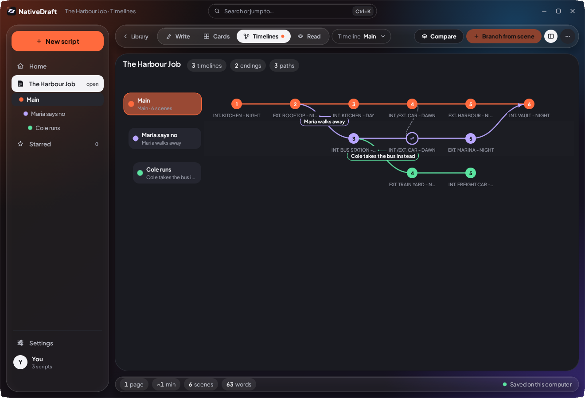

- **Main** is the script as you have always written it. Each scene is a dot.
- **Branch from a scene** (`Ctrl+Shift+B` in Write, a right-click on a dot,
  or *Branch from scene* in the Timelines view): name the timeline and the
  choice that leads there, and, if you like, what staying on Main is called.
  The new timeline shares everything up to that scene and then goes its own
  way. Timelines can branch again, as deep as you need.
- **Same scene.** When a branch goes through a scene that happens exactly as
  it does in a timeline it came from, open the branch, find that scene in the
  Timelines view, right-click it and choose *Show in (the branch) as a Same
  scene*. It appears in the branch as a locked card, always in step with
  the original; *Edit in Main* takes you to it, and *Make it its own* copies
  it in so it can change.
- **Merge.** When a branch rejoins the story, open the branch, right-click
  the scene it flows into and choose *Merge (the branch) into here*. Nothing is folded away: the branch stays a
  timeline of its own, and the graph draws the arrow back.
- **Writing in a branch.** The page opens with the timeline's name, where it
  branches from and the choice, with **The story so far** folded beneath. Its
  scenes are numbered after the scenes it shares, Read turns the pages of the
  whole story, and the status pill counts all of it.
- **The graph** shows how many timelines, endings and paths the story has, and
  anything that needs a look (a scene a timeline used that is gone, a merge
  that loops back). Arrow keys move between scenes, `Enter` opens one.
  Right-click a timeline's name to rename it, change the choice, its colour,
  duplicate it or delete it. **Compare** sets two timelines side by side,
  scene against scene.
- **Switch timelines** from the sidebar (they sit under the open script), the
  *Timeline* menu in the toolbar or `Ctrl+K`.
- **Exports.** From a branch, PDF, Fountain and Final Draft export its whole
  story. *Every timeline* writes one file per timeline into a folder. For
  games, ⋯ → Export has **Ink**, **Yarn Spinner** and a **JSON graph**: one
  knot or node per scene, the choices at every fork, merges as jumps.
- **Reports** read any timeline's whole story, and list the characters and
  places only the branches have.

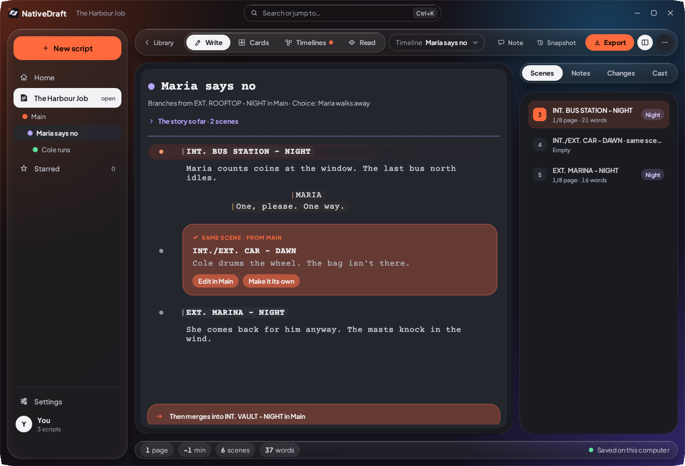

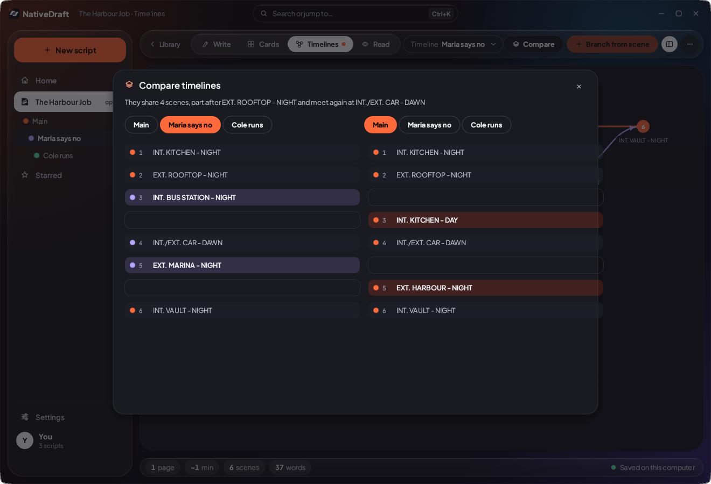

**Safe by design.** A branch is its own file in a hidden folder beside the
script (`scripts/the-harbour-job.timelines/maria-says-no.md`), so the script
itself never changes shape. The one thing written into it is a short id on
the card of a scene a timeline refers to (`<!-- scene: … | id=k3f9q2 -->`),
and only once you branch; older versions of NativeDraft keep it and write it
back untouched. Delete a scene a timeline uses and NativeDraft says which
timelines use it, moves them to the scenes beside it, and `Ctrl+Z` puts every
file back. Renaming, duplicating and deleting a script take its timelines
along. Timelines live on this computer for now; NativeCloud gets them next.

---

## Anything that deletes, asks

Deleting a script, deleting a scene and restoring a snapshot each bring a
compact card to the **middle of the screen**, growing into place with a little
overshoot. The window dims behind it and it takes the keyboard — `Enter` to go
through with it, `Esc` to back out. Everything else arrives as a **notch**: a
single-line pill that springs up well clear of the bottom edge, says its piece,
and goes.

---

## Acts, colours and shortcuts

- **Acts.** *New act* (or Ctrl+Shift+Enter) starts an act where the cursor
  is: on the next line, or with the scene when the cursor is in its heading.
  In the script it is a chapter heading — a HUD line saying what the act
  holds, then its title set giant; in
  print every act starts a new page with its title centred, bold and
  underlined, and closes with a centred `END OF ACT ONE`. In the file it is a
  level-one heading, `# ACT ONE`. Fountain and Final Draft carry acts both
  ways.
- **Chosen character colours.** Character colours can be *Random* (dealt from
  the wheel, as before) or *Custom*: click a character's colour in the Cast
  panel or in Settings → Colour and choose one, and they keep it everywhere,
  on paper too. The choice is kept in the script's front matter
  (`voices: MARIA=212; COLE=24`), so anyone you share the script with sees it.
- **Your own shortcuts.** Settings → Keyboard lists every shortcut. Click
  one and press the keys you want instead; *Reset all to default* puts back
  the ones above. They are kept with your own settings, so each person has
  their own, and only the shortcuts you changed are written down.

The app opens on **Home**: Continue writing, the week, the next deadline and
your scripts. Scripts without acts or chosen
colours are written exactly as before.

A speech that runs over a page break is printed the industry way: `(MORE)` at
the foot of the page, and the cue again with `(CONT'D)` at the top of the
next. Both are added by the layout — in the PDF, Reading mode and the page
count — and never written into your script.

---

## Contributing

NativeDraft is open source under the MIT licence, and contributions are
welcome: bug reports, fixes, features and translations of the docs. Start with
[CONTRIBUTING.md](CONTRIBUTING.md); security problems go through
[SECURITY.md](SECURITY.md), not the public tracker. Everyone taking part
follows the [code of conduct](CODE_OF_CONDUCT.md).

---

## Development

```bash
cargo test          # 197 tests: behaviour, files, formats, headless UI
cargo build --release
./target/release/nativedraft --emit-icon icon.svg   # the mark, as the app draws it
./target/release/nativedraft --emit-ico packaging/nativedraft.ico   # the Windows icon
./target/release/nativedraft --smoke /tmp/smoke     # the real window, every screen, checked
packaging/macos/bundle.sh                         # on a Mac: the universal, signed NativeDraft.app
```

`--smoke <folder>` opens the real window with a throwaway library in that
folder, walks through every screen, screenshots each one and checks it is not
blank, exports a PDF, imports a file, quits with an unsaved edit and checks it
was saved. It writes `report.txt` and exits 0 only if all of it held. CI runs
it on Linux and on four Macs (Apple Silicon and Intel, macOS 15 and 26) with
Metal and with OpenGL, then installs the released `.zip` on fresh Macs with
`install-macos.sh`, opens it through macOS, updates it while it is open and
uninstalls it (`packaging/macos/verify-install.sh`).

The headless UI tests build a real `App`, feed it synthetic clicks, drags,
pastes and keystrokes through egui with no window, and read back what
happened — so the editor's keys, the cards' drag, the confirmations and both
the dark and light casts are all exercised for real.

| File | Contents |
|---|---|
| `src/lib.rs` / `src/main.rs` | The app is a library; the desktop binary runs it on a window |
| `src/backend.rs` | The `Store` trait the app reads and writes through; `LocalBackend` is the library folder |
| `src/model.rs` | Elements, indents, blocks, scenes, cast, word wrap, paste guessing, SmartType |
| `src/storage.rs` | The library folder, markdown read/write, snapshots, settings, import |
| `src/export.rs` | Line composition, pagination (and locked pages with A-pages), page map, scene lengths, PDF/FDX/Fountain/text |
| `src/fountain.rs` | Fountain and Final Draft readers |
| `src/editor.rs` | The page: block rendering and every structural keystroke |
| `src/cards.rs` / `src/pages.rs` | Cards, and Reading mode |
| `src/app.rs` | The app: title bar, popovers, the page, autosave, undo |
| `src/app/shell.rs` | The library sidebar, the toolbar and status pills, the tabs on the right, the title page |
| `src/app/palette.rs` | Search or jump to (`Ctrl+K`) |
| `src/app/home.rs` | Home: the hero, Continue writing, the week, the next deadline, the scripts, and search inside every script |
| `src/stats.rs` | The word log, the places you left off, and deadlines |
| `src/art.rs` | The glass art on Home, one image per look (`assets/art/`) |
| `src/app/notes.rs` | The note window, the Notes and Changes lists, starting and ending a revision |
| `src/app/reports.rs` `src/report.rs` | The Reports window, and the figures behind it |
| `src/app/imported.rs` | The window listing what an import could not keep |
| `src/app/onboarding.rs` | The tour and *what's new* |
| `src/revision.rs` | Revision colours, the diff against the starting snapshot |
| `src/app/team.rs` `src/people.rs` | Screens for a shared library: read-only scripts, history, members, avatars. Not shown for a library on disk |
| `src/app/voices.rs` | Choosing character colours: Random or Custom, the colour picker |
| `src/keys.rs` `src/app/keyboard.rs` | Every shortcut and its default chords, the ones you choose instead, and Settings → Keyboard |
| `src/theme.rs` | NativeDraft's own colours on top of NCF: element and character colours, the floating toolbar and sheets, the page font, the older palette names |
| `src/ui.rs` `chrome.rs` `splash.rs` `logo.rs` | NativeDraft's name and mark handed to NCF's controls, title bar, splash and icons |

The look, the controls, notices, icons, the update check and the text cursor
come from [NCF](https://github.com/NativeCompute/ncf), the NativeCompute
Framework, pinned in `Cargo.toml`. NativeDraft is pinned to `eframe`/`egui` 0.29
through it.

MIT licensed. Courier Prime is bundled under the SIL Open Font License; see
`assets/fonts/`. Bricolage Grotesque, Plus Jakarta Sans and JetBrains Mono
come with NCF under the same licence. The icon's ribbon is
`assets/icon/mark.png`; NCF draws it on the tile. printpdf 0.7.0 is vendored (MIT) with a
two-line fix so it also builds for WebAssembly; see
`vendor/printpdf/VENDORED.md`.

Made by [NativeCompute](https://nativecompute.net).
